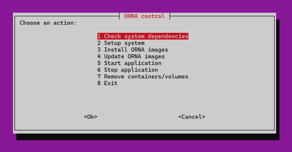
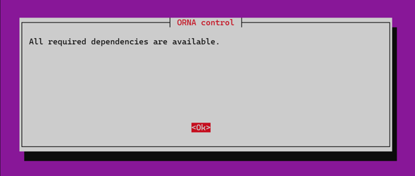
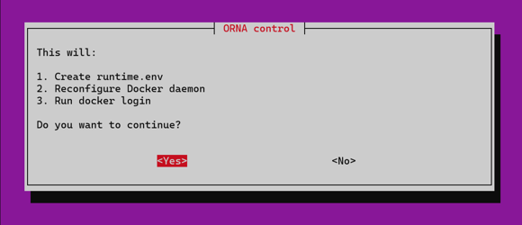
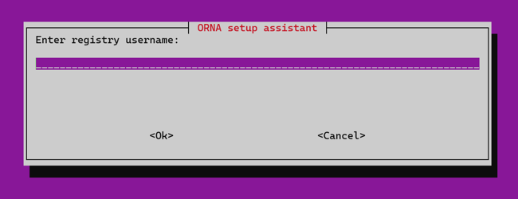
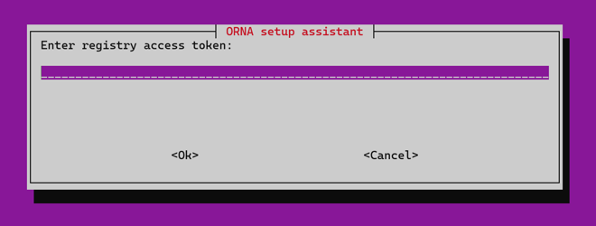
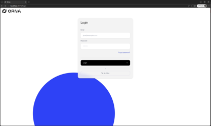
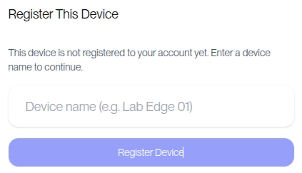
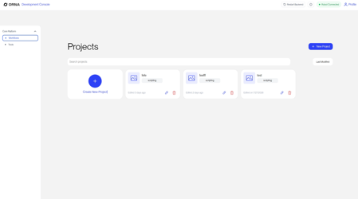

# Advantech WEDA Onboarding

## ORNA — AI Robotics Platform Container for Advantech Edge Devices

> Deploy AI-powered robot vision and orchestration on Advantech edge hardware. Frontier AI-powered Perception, natural-language robot programming, and deterministic execution for Industrial Robots

---

## Container Functional Overview

This container provides the complete ORNA runtime environment for [FILL: supported Advantech platforms], including:

- ORNA Core runtime (OrnaPy SDK + execution engine)
- Vision stack: Deep Learning Model, Grounding DINO zero-shot detection, SAM2, pose estimation
- Robot drivers: UR RTDE driver
- Camera drivers: Orbbec SDK + supported models 335Lg/335Le
- Web UI: Workcell Configurator, Smart Annotator, IDE Mode, Live Diagnosis

Designed for deployment by system integrators and automation engineers on Advantech edge devices — no robotics AI expertise required.

---

## Supported Host Device List

<!-- Advantech's table format. Only list what has actually been validated. Use "Tested" / "Compatible (not validated)" honestly. -->

| Platform | GPU | Compatibility |
| --- | --- | --- |
| MIC-770 V3 | NVIDIA® RTX A2000 12GB | Tested |
| AIR-030 | NVIDIA® Jetson AGX Orin™ | Tested |
| MIC-733-AO | NVIDIA® Jetson AGX Orin™ | Tested |

---

## Supported Peripherals

| Category | Validated Hardware |
| --- | --- |
| Robot | Universal Robots |
| 3D Camera | Orbbec Gemini 335Lg / 335Le |
| Gripper | DH-Robotics AG-95 |

---

## Prerequisite Software on the Host OS (Required)

Before running the container, ensure the host system has the following installed:

- **Docker Engine** Installation guide: https://docs.docker.com/engine/install/
- **NVIDIA Container Toolkit** Required for GPU-accelerated inference. Installation guide: https://docs.nvidia.com/datacenter/cloud-native/container-toolkit/latest/install-guide.html
- **NVIDIA Driver**

---

## Quick Start Guide

### 1. Install ORNA on your system

#### 1.1. Clone the orna\_system repo and start the control program

Go to the orna\_system folder and run:

```
bash orna.sh
```



Then run **1 Check system dependencies** and **2 Setup system** to verify and configure your system.



Choose “Yes” here:



#### 1.2. Install ORNA images

Go to **3 install ORNA images,** enter your Harbor credentials, and it will download the latest images (currently v0.2.0).





Type in your Harbor username and password for “registry username and access token”

### 2. Start using ORNA

#### 2.1. Connect the peripherals

Connect the necessary peripherals—the robot's patch cord and the gripper and camera cables—to your edge before starting ORNA.

#### 2.2. Start ORNA

Use **5 Start application** to start ORNA

#### 2.3. Use ORNA

If the edge and your device share the same subnet, open a browser to `[edge ip]:4173` to reach the login page.

If you use a browser on the edge, open `[edge ip]:4173` or `localhost:4173` to reach the login page.



Log in with your ORNA credentials and register your device with a name on the next page to reach the ORNA main page.





You should see the green “robot connected” icon at the top-right corner when the robot is connected to the edge. Enjoy ORNA!