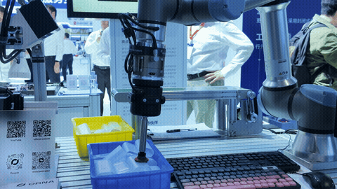
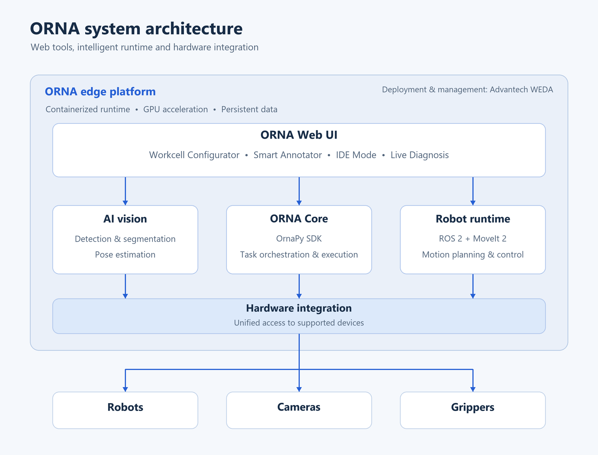
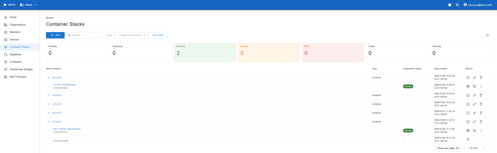

# Advantech WEDA Onboarding

## ORNA — AI Robotics Platform Container for Advantech Edge Devices

> Deploy AI-powered robot vision and orchestration on Advantech edge hardware. Frontier AI-powered Perception, natural-language robot programming, and deterministic execution for Industrial Robots

---


## Container Functional Overview

This container provides the complete ORNA runtime environment for Advantech edge devices, such as MIC-770 V3, AIR-030, and MIC-733-AO, including:

- ORNA Core runtime (OrnaPy SDK + execution engine)
- Vision stack: Deep Learning Model, Grounding DINO zero-shot detection, SAM2, pose estimation
- Robot support: Major brands such as Universal Robots
- Camera support: Major brands such as Orbbec
- Web UI: Workcell Configurator, Smart Annotator, IDE Mode, Live Diagnosis

Designed for deployment by system integrators and automation engineers on Advantech edge devices — no robotics AI expertise required.

---

## Container Key Features

- **Natural-language robot programming** — Describe tasks in plain language and execute them through the ORNA runtime.
- **AI-powered perception** — Combine trained object detection, zero-shot detection, segmentation, and pose estimation for robotic vision tasks.
- **Workcell configuration** — Configure robots, cameras, and grippers through the web-based Workcell Configurator.
- **Integrated development tools** — Annotate images with Smart Annotator, develop workflows in IDE Mode, and inspect system behavior with Live Diagnosis.
- **GPU-accelerated edge deployment** — Run the containerized runtime on supported Advantech platforms with NVIDIA GPUs.

---

## Architecture Diagram

The ORNA Web UI provides tools for workcell configuration, development, and diagnosis. The edge runtime combines ORNA Core, AI vision, and ROS 2 / MoveIt 2 for task orchestration, motion planning, and integration with supported robots, cameras, and grippers.



---

## SW Components

| Component | Purpose |
| --- | --- |
| ORNA Core (OrnaPy SDK + execution engine) | Robot task orchestration and execution |
| ROS 2 Humble + MoveIt 2 | Robot communication, motion planning, and planning scene management |
| AI vision stack | Deep learning detection, Grounding DINO, SAM2 segmentation, and pose estimation |
| Hardware integration | Support for major robot and camera brands, such as Universal Robots and Orbbec, and supported grippers |
| ORNA Web UI | Workcell Configurator, Smart Annotator, IDE Mode, and Live Diagnosis |
| NGINX | Web UI hosting |

---

## Device OS

- **MIC-770 V3 (x86_64):** Ubuntu 22.04 LTS with NVIDIA drivers.
- **AIR-030 / MIC-733-AO (Jetson):** NVIDIA JetPack with Ubuntu 22.04. The host JetPack/L4T version must match the requirements of the selected Jetson image.

All devices require Docker Engine and NVIDIA Container Toolkit.

---

## Container OS

| Container | Base OS |
| --- | --- |
| ORNA service (x86_64) | Ubuntu 22.04 LTS |
| ORNA service (Jetson) | Ubuntu 22.04-based NVIDIA L4T JetPack image (r36.4.0) |
| ORNA Web UI | Alpine Linux (NGINX image) |

---

## Supported Host Device List

<!-- Advantech's table format. Only list what has actually been validated. Use "Tested" / "Compatible (not validated)" honestly. -->

| Platform | GPU | Compatibility |
| --- | --- | --- |
| MIC-770 V3 | NVIDIA® RTX A2000 12GB | Tested |
| AIR-030 | NVIDIA® Jetson AGX Orin™ | Tested |
| MIC-733-AO | NVIDIA® Jetson AGX Orin™ | Tested |

---

## Supported Peripherals

| Category | Supported Hardware Examples |
| --- | --- |
| Robot | Universal Robots |
| 3D Camera | Orbbec |
| Gripper | DH-Robotics AG-95 |

---

## Prerequisite Software on the Host OS (Required)

Before running the container, ensure the host system has the following installed:

- **Docker Engine** Installation guide: https://docs.docker.com/engine/install/
- **NVIDIA Container Toolkit** Required for GPU-accelerated inference. Installation guide: https://docs.nvidia.com/datacenter/cloud-native/container-toolkit/latest/install-guide.html
- **NVIDIA Driver**

---

## Integration with WEDA

ORNA supports deployment and container management through Advantech WEDA on supported edge devices.



---

## Quick Start Guide

### 1. Install ORNA on your system

#### 1.1. Clone this repository and start the control program

Clone the repository and start the control program:

```bash
git clone https://github.com/Advantech-Containers/ORNA-Robotics-Container.git
cd ORNA-Robotics-Container
bash orna.sh
```


Then run **1 Check system dependencies** and **2 Setup system** to verify and configure your system.


Choose “Yes” here:


#### 1.2. Install ORNA images

Go to **3 install ORNA images,** enter your Harbor credentials, and it will download the configured service, UI, and IDE images (default: v0.3.0).


Type in your Harbor username and password for “registry username and access token”

### 2. Start using ORNA

#### 2.1. Connect the peripherals

Connect the necessary peripherals—the robot's patch cord and the gripper and camera cables—to your edge before starting ORNA.

#### 2.2. Start ORNA

Use **5 Start application** to start ORNA

#### 2.3. Use ORNA

If the edge and your device share the same subnet, open a browser to `[edge ip]:4173` to reach the login page.

If you use a browser on the edge, open `[edge ip]:4173` or `localhost:4173` to reach the login page.


Log in with your ORNA credentials and register your device with a name on the next page to reach the ORNA main page.


You should see the green “robot connected” icon at the top-right corner when the robot is connected to the edge. Enjoy ORNA!
